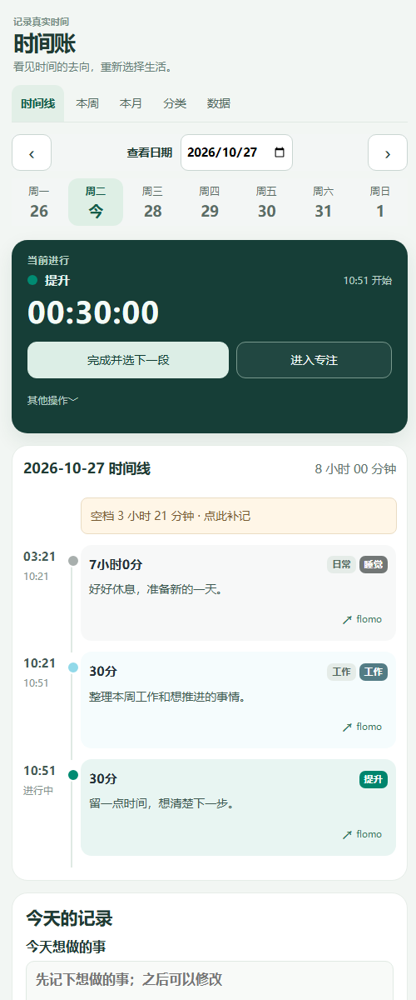
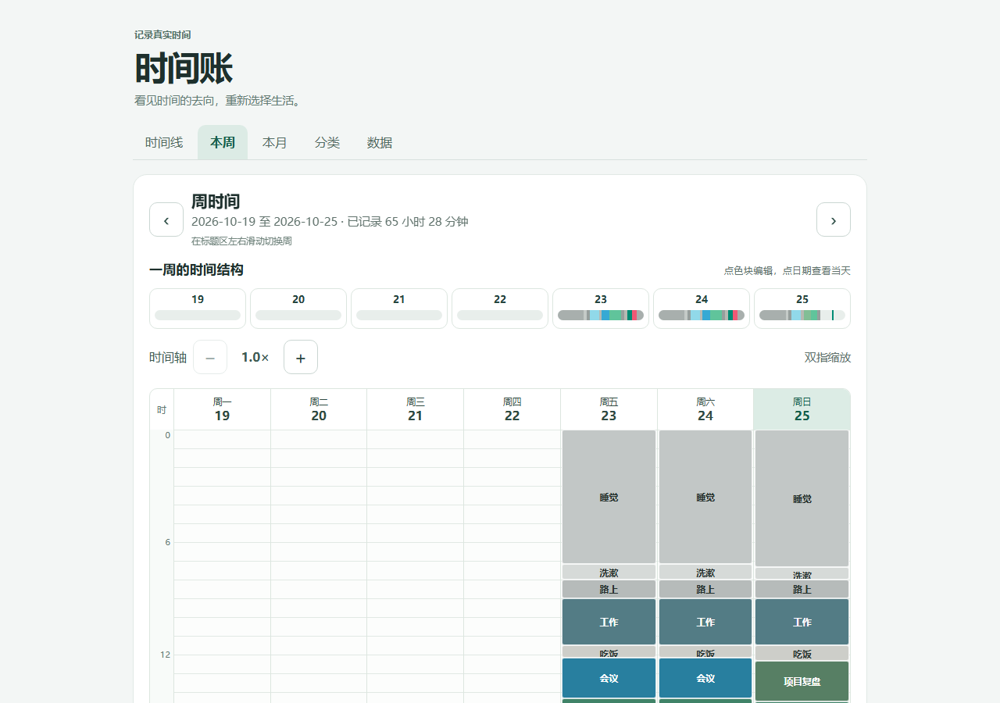

# 时间账 · Time Ledger

[English](README.en.md) · [下载 Android 预览版](https://github.com/LuluCJJ/time-ledger/releases/tag/v1.0.0-preview.1) · [更新记录](CHANGELOG.md) · [产品原则](docs/PRODUCT.md) · [数据与隐私](docs/DATA.md) · [参与贡献](CONTRIBUTING.md)

**把时间记清楚，才有机会重新选择怎么生活。** 时间账是一款以手机本地记录为主的个人时间账本。开始一段活动时记下起点，切换时结清上一段；之后可以修正时间、分类和备注，并按日、周、月回看生活的实际构成。

## 为什么做

这个项目始于听[《纵横四海》EP38《时间贫困》](https://www.xiaoyuzhoufm.com/episode/657d53aa20d779b49d86d299)。节目里的时间记录话题让我开始关注：生活中哪些事真正占用了时间，哪些感受与事实不一致。然后也开始用播客里提到的一些工具和方法尝试记录自己的生活。

记录得越久，我越希望它不只回答“花了多久”，还能帮助我记住做了什么、回看一周的时间结构、写下自己的判断，并把历史记录完整带走。这些需求促使我独立做了时间账。它与上述播客、原 App 均无官方关联；仓库不包含原产品的 APK、代码、界面素材或用户数据。

## 我们怎么理解时间记录

1. **先记录事实，再解释意义。** 保存实际起止时间；经过时长由起点和当前时间计算。分类分布可以重新计算，复盘文字由使用者自己写。
2. **允许生活有空白。** 未记录的几分钟可以留空，不为了让图表完整而编造活动。
3. **让一个人可靠地用起来。** Android 设备可以是主账本，记录留在本机，用户可导出完整备份；使用不依赖云同步。
4. **从账本回到行动。** 时间线、周月结构、专注时钟与总结用于回看和调整，不给每一分钟打分。

## 近期更新

**2026-10-29 · 最新源码：**暖白界面、分类图标、周/月环形图、紧凑备注与手机底部导航。[查看更新记录](CHANGELOG.md)。

**2026-10-27 · 已更新源码，安装包待发布：** 首页时间线更易浏览，分类分层展示；专注页支持随手记录、留白提示和切换下一段。[查看本次更新](CHANGELOG.md#2026-10-27--源码更新尚未发布安装包)。

**当前公开下载：** [v1.0.0-preview.1 · 2026-10-25](https://github.com/LuluCJJ/time-ledger/releases/tag/v1.0.0-preview.1)。该安装包早于上述源码更新。[全部更新记录](CHANGELOG.md)。

## 怎么使用

开始一段活动时，只需记下分类和起点；切换时结清上一段。时间线保留真实起止与备注，周视图把工作、提升、日常和娱乐放在同一张时间地图上。想专心做一件事时，打开专注时钟，按需记录想法，或展开留白提示回看当天计划和以前的备注。这些内容保存在当前活动的同一条备注里，不会自动产生新时间段。完成后可以直接切换到下一段，再回到日、周、月复盘。

以下画面来自当前网页界面，使用**完全虚构的示例记录**；Android 版会随屏幕尺寸调整布局。

### 日时间线：记录、补记、修改



### 周时间地图：看时间分布和空档



### 专注时钟：只看这一段


**数据由你保管。** 记录默认留在当前设备；可导出可读 Excel，也可导出用于完整恢复的 JSON。当前没有自动云同步。[了解数据边界](docs/DATA.md)。

**安装提醒：** 上方截图和功能说明对应最新源码；现有公开 APK 仍为较早版本，不包含本轮视觉与留白更新。[公开的 Android 预览版](https://github.com/LuluCJJ/time-ledger/releases/tag/v1.0.0-preview.1)与早期试用版是两个独立应用，不会自动带入旧记录。跨应用迁移尚未经过独立 Android 真机验收；已有记录的使用者请保留原应用与完整备份。见[当前限制](docs/STATUS.md)。

## 已实现的主要流程

- 开始、结束、继续下一段；更正起止时间，编辑备注，处理相邻时间冲突。
- 一条记录选择一个有层级和颜色的分类；日时间线与周／月预览。
- 专注时钟按真实起点显示经过时长，可设置预计结束；Android 端支持亮屏、横屏与沉浸全屏。留白提示和随手记录使用同一条活动备注，不额外计时。
- 每日计划与总结、周月分类分布和手写复盘。
- 导入旧「时间日志」的 `.xls`／同结构 `.xlsx`；导出便于阅读的五工作表 Excel、可完整恢复的 JSON 备份或两类 CSV。时间账导出的可读 Excel 也能重新导入主要内容，但不包含全部内部来源细节；需要完整恢复时使用 JSON。导入前可预览。
- 可选择将备注或总结填入 Flomo 草稿；直接发送需使用者自己在本机配置接入地址。

一些能力仍需真机和真实迁移验收，详见[当前限制](docs/STATUS.md)。仓库提供的是可继续开发的版本，不应仅凭构建成功就视为备份和迁移可靠。

## 本地运行

发布前的本地源码检查可在仓库根目录运行 `node scripts/verify-source.mjs`；它依次运行网页测试、当前文件检查、Git 历史检查和差异格式检查。手机数据恢复、图片人工审查与正式签名仍须单独验收。

网页源码在 `web/`。在该目录运行 `node dev-server.mjs`，再访问 `http://127.0.0.1:4174/`。浏览器与 APK 的本地记录各自独立。

Android 和桌面封装在 `shells/`：

```text
cd shells
npm ci
npm run android:debug-apk
npm run desktop:package
```

桌面打包会重新准备临时资源，并自动核对包内应用文件、四份许可文本及 Electron/Chromium 许可文件；若文件不符，命令会失败。这个检查不能替代运行测试或正式发布审核。

Android 构建需要 Java 和 Android SDK；首次构建还会下载 Gradle 依赖。网页逻辑检查可在 `web/` 运行 `node --test *.test.mjs`。`web/legacy_xls_converter.py` 是供核对旧 Excel 转换的独立工具，需另装 Python 包 `xlrd`；用户在网页或 APK 中导入 Excel 不依赖 Python。已有试用版的手机在升级前应取得非零且经隔离恢复核对的完整备份；仅凭同签名可以覆盖安装，并不表示此刻适合升级。不要卸载或清除应用数据。改用正式签名时须先完成独立恢复演练和数据转移。

如需在本机只读核对一份旧导出，可运行 `node web/excel-import-smoke.mjs <原始XLS路径>`。Windows 默认使用 `py -3`，其他系统默认使用 `python3`；也可在路径后传入自选 Python 解释器。脚本只输出数量和哈希摘要，不输出备注正文。

Android 图标与启动画面的源脚本在 `shells/scripts/generate-brand-assets.py`。只有重新生成图片时需要 Python Pillow；普通 APK 构建直接使用仓库内的图片资源。

## 项目结构

```text
web/       页面、数据模型、导入导出、测试
shells/    Android / Windows 容器及构建脚本
docs/      产品原则、隐私与当前状态
```

**隐私边界：** 仓库只收录源码、虚构样本、测试和公开说明。真实时间记录、旧 Excel、个人 Wiki、录屏、Flomo 接入地址、签名密钥和生成的 APK/EXE 不属于公开源码。提交前请按 [数据与隐私](docs/DATA.md) 自查。

本项目原创代码与文档采用 [Apache License 2.0](LICENSE)。第三方组件按各自许可证使用，见[第三方组件](docs/THIRD_PARTY.md)。[Android 1.0 预览版 APK](https://github.com/LuluCJJ/time-ledger/releases/tag/v1.0.0-preview.1) 已公开；它与现用试用版数据独立，正式版迁移尚未经真机验证，详见[当前状态](docs/STATUS.md)。
